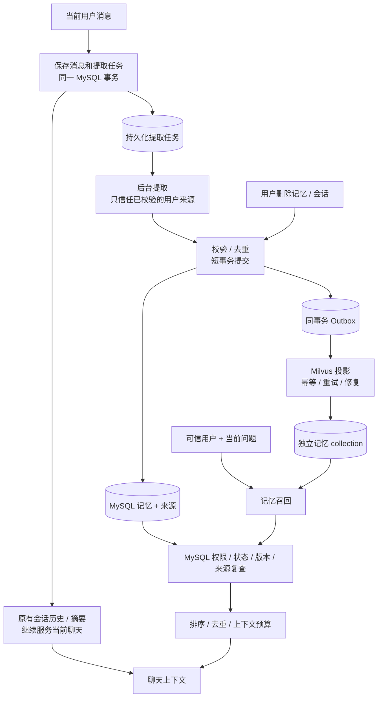

# 聊天结构化长期记忆：第一期设计

日期：2026-10-26。状态：第一期代码、单元/架构/全量回归及临时 MySQL 迁移与事务回滚验证已完成；真实 Milvus 集成测试资产已补齐，但当前环境无 Milvus，真实 upsert/search/delete 联调仍待具备服务与 Embedding 凭证后执行。

## 1. 目标与范围

用户认可完整长期记忆目标，并同意分期交付。第一期只覆盖聊天跨会话记忆，保留现有会话压缩，完成“提取 → MySQL 持久化 → 事务 Outbox → Milvus 投影 → 按用户召回 → 删除”的可恢复闭环。

- 复用现有 MySQL、Milvus 实例、EmbeddingModel 和模型路由；不引入新的服务、消息中间件或 Maven 模块。
- Milvus 使用独立记忆 collection，不使用 `interview_notes` 或图片 collection。
- Neo4j 关系增强、双投影对账、学习/面试/练习反馈自动接入、自动衰减、复杂冲突合并、全局 Agent 记忆接入和前端记忆管理页面属于后续阶段。
- 第一期必须包含单一 Milvus 投影的基础修复能力；不能把“失败重试、旧版本清理、删除残留修复”全部推迟到第二期。
- 记忆来自用户自述，不作为技术知识证据或业务掌握度评分，不覆盖 Learning 的画像真相源。
- 不处理旧记忆或回填历史消息，不做兼容双写；仅为新能力启用后新保存的 user 消息创建提取任务。旧数据不迁移、不清空。

## 2. 代码核对得到的现状

基线：`e6a707a`，分支 `codex/rag-retrieval-simplification`。

1. `ChatContextCompressor` 负责当前消息窗口、异步摘要和 `summary_up_to_msg_id`；跨会话记忆只在摘要压缩完成后通过 `CROSS_SESSION_MEMORIZE` 触发。
2. `ChatMemoryExtractorAgent` 读取会话摘要，与已有 `t_user_chat_memory.memory_text` 一起交给 LLM 整段重写；`last_session_id` 只能记住最后一个会话，不能表达一次会话的多轮增量处理。
3. `AutoDreamService` 也重写同一段文本。表中的 `version` 不意味着当前 wrapper update 路径已经具备正确的 CAS 并发保护。
4. `WebChatService.buildHistoryContext(sessionId)` 没有当前问题参数；流式入口有 `userId` 和当前问题，但现有路径不能直接执行定向语义记忆召回。
5. `ChatSessionDO` 和 `ChatMessageDO` 都有 `@TableLogic`。`WebChatService.deleteSession` 调用 Mapper delete；不能仅因调用名为 delete 就宣称物理删除。
6. `ChatController` 的 rename/delete/listMessages 接口未显式传递当前身份，stream 路径也需以实际 ownership 查询验证，而不是依赖注释。扩大长期记忆前必须补齐这些相关入口。
7. 默认 `app.security.mode=open` 返回共享的 `default-user`；当前 identity resolver 的 JWT payload 解析是身份识别，不是签名验证。多租户安全不能依赖 Header 或未验证的 JWT。
8. Flyway 当前只有 V1/V2，迁移变更必须新增版本，不修改已应用迁移。
9. 图工具已尝试，出现“list_projects 可见而 search_graph 报未索引”的不一致，当前设计据实际源码核对；不能把旧图中的构造签名当作当前事实。

## 3. 选择及职责归属

### 三种路径

- 仅 MySQL 条目化：最轻，但不能验证向量召回和多存储一致性目标。
- **聊天闭环 + MySQL Outbox + Milvus（选择）**：一条生产可验证链路，暂不做泛化平台。
- 同时接入所有业务、Neo4j、安全审计后台与遗忘策略：本次范围过大，延后。

### 第一期包归属

所有新记忆业务归 `chat`，不新建顶层 `memory` 模块，不把个人记忆塞入 `knowledge`。

| 包 / 组件 | 职责 |
| --- | --- |
| `chat.application.memory` | 提取任务调度、LLM 提取校验、记忆提交、召回、用户查看/删除 |
| `chat.domain.memory` | 分类、状态、候选、来源引用、去重规则；不依赖 Spring AI/MyBatis |
| `chat.infrastructure.persistence.memory` | 记忆、来源、提取任务、Outbox 的 DO/Mapper 和有事务语义的存储协作 |
| `chat.infrastructure.milvus` | collection/schema、embedding 与投影协议、Milvus 查询/删除/遍历 |
| `chat.api` | 记忆列表/删除 API，解析可信身份，只调用 application service |

实际协作组件采用具体实现，不机械增加单实现接口、Registry、Factory、通用事件平台。将来出现 Learning/Interview 的真实记忆调用方时再定义 Chat 公开契约；本期不建立空的跨模块记忆契约。

模型调用走 `RoutingChatService`；结构化解析复用 `modelrouting.application.contract.structuredoutput.StructuredOutputParser`。Milvus/Embedding SDK 类型不向 API/domain/公开契约泄漏。Prompt 复用 Chat 的管理机制，新模板独立命名，不覆盖用户定制的旧模板。

## 4. 第一期开箱链路

会话摘要不是新的 durable memory 唯一输入。短会话也可产生记忆；异步结果用于后续轮次/会话，不承诺当前消息在本轮已变为可召回长期记忆。

## 5. 最小持久化模型

新增四张 Chat-owned 表，V3 管理结构，V4 添加新的必要提示词参考数据；实施前复核迁移号仍未占用。关系约束与被删除的 session/source 关联不会依赖级联物理删除；引用完整性由相同 Chat-owned 事务保证，缺失来源时读取默认拒绝。

### 5.1 `t_chat_memory_item`

- `id`：BIGINT 主键，稳定记忆 ID。
- `user_id`：VARCHAR(128)，非空；唯一/过滤键使用精确、大小写敏感比较，不能继承默认 collation 造成用户合并。
- `category`：`PREFERENCE | GOAL | FACT | CONSTRAINT`。
- `content`：最多 500 Unicode code points 的描述性用户自述，不保存模型指令或结构化工具动作。
- `content_hash`：由 category + 规范化 content 计算；只能用于内部精确去重，不导出。
- `status`：`ACTIVE | QUARANTINED | DELETED`。本期不实现自动 Supersede；相互矛盾的事实不会自动确定哪条正确，用户可通过列表/删除纠正，不能宣称第一期已实现 Saber 的完整冲突治理。
- `version`：BIGINT；有效状态、内容或来源变化通过显式 CAS 更新，不能只放 `@Version` 却用绕过它的 wrapper update。
- `created_at / updated_at / deleted_at`。
- 唯一键 `(user_id, category, content_hash)`；查询索引 `(user_id, status, updated_at, id)`。

不把 LLM 自评 confidence 当作校准概率，不先添加没有生产语义的 importance/TTL/slot_hint。类别到上下文段落的映射是确定性规则。可以以后依据评测添加评分。

### 5.2 `t_chat_memory_source`

- `memory_id / user_id / session_id / source_message_id / source_message_pk`。
- `source_start / source_end`：在用户消息中的 Unicode code point 区间；服务端验证引文确实来自该区间后只保存引用，不重复存储整段用户消息。
- `created_at / invalidated_at`。
- 同一记忆可有多条来源；唯一 `(memory_id, source_message_id, source_start, source_end)`。
- 索引 `(user_id, session_id, memory_id)`、`source_message_id`。

来源必须属于同一用户的未删除会话、未删除 user 消息。Assistant 回答、system、工具结果、占位输出均不能作为用户事实来源。候选事实只要求与用户原文有可核对引文，不宣称 LLM 语义解释已被形式化证明正确。

### 5.3 `t_chat_memory_extraction_task`

- `task_id / user_id / session_id / source_message_id / source_message_pk`。
- `status`：`PENDING | PROCESSING | RETRY | DONE | DEAD | CANCELLED`。
- `attempt_count / next_attempt_at / lease_until / lease_token / error_code / created_at / updated_at`。
- 唯一 `source_message_id`，不复制消息原文到任务 JSON。
- worker 提交候选与将 task 置 DONE 同事务；重试不会重复提交来源。

### 5.4 `t_chat_memory_outbox`

- `event_id / memory_id / user_id / memory_version / target / operation`，本期 target 只有 MILVUS；`user_id` 用于 item 异常缺失时仍能执行租户隔离的物理清理。
- `status / attempt_count / next_attempt_at / lease_until / lease_token / error_code / created_at / updated_at`。
- 唯一 `(memory_id, memory_version, target, operation)`。
- 事件只存 owner/ID/版本和操作，不保存正文快照；投影前读取 MySQL 当前有效状态。

未增加消息中间件。事务 Outbox 与提取任务不同：前者保证已提交记忆投影可恢复，后者保证消息提交后模型提取任务不会仅因进程重启而丢失。

## 6. 写入与提取

1. 将 user 消息插入、会话 touch、提取任务 insert 放入同一短事务；task insert 失败必须回滚消息事务，不得吞掉失败然后宣称 durable。当前消息的模型回复不等待后台长期记忆提取。
2. 每条 user 消息最多一个任务。后台延迟 15 秒处理，可在同一会话一次模型调用批处理最多 8 条任务；保证短会话也会处理。
3. MySQL 8 的 `FOR UPDATE SKIP LOCKED` 短事务领取任务，lease/token 写入后立即提交；模型调用不持有 DB 锁。候选提交只有 lease token 仍匹配时可以推进任务终态。
4. 模型输入只包括所领取的 user 消息；可带最多 4 条之前已完成的对话供理解指代，但只允许引用领取消息。每批最多 10,000 code points，单消息超限不静默裁成错误事实，记为 `INPUT_TOO_LARGE` 并保留明确失败状态。
5. 输出严格 JSON，最多 8 条候选；包含 category、content、sourceMessageId、quote。不允许模型设置 userId、status、memoryId、SQL、工具指令。
6. 校验枚举、数量、长度、来源归属及原文引文；失败不改变已有记忆，不用自然语言 fallback 写入。明确命中的提示注入/凭证等规则候选不进入 ACTIVE，记录受控拒绝码，不持久化凭证明文。
7. 精确去重采用 NFKC + 空白归一化 + 保留大小写；语义近似去重和自动冲突替代不在本期。
8. 同用户同类别同 hash：ACTIVE 条目补充有效来源（来源变更需要 version + Outbox）；DELETED/QUARANTINED 条目不由自动提取激活。客户端无权通过伪造 contentHash 绕过去重。
9. 候选事务同时写 item/source/Outbox、将本批任务置 DONE，并再次检查源会话/消息未删除。删除会话与来源提交在 session row 上协调，防止删除后正在运行的任务重新提交来源。
10. 多任务/多会话并发依靠唯一约束、显式版本 CAS 和固定锁顺序（session → task → memory ID 升序）协调；发生冲突重新读取当前状态并有限重试，不覆盖他人版本。
11. LLM 失败：受控错误码 + 指数退避，总共 5 次尝试；DEAD 保留且可由明确运维命令重置重试，不无限刷模型。

## 7. Milvus 投影与一致性

### schema 与隔离

独立 collection 默认 `chat_memories`。使用现有文本 embedding 模型，维度从现有配置获取（当前 2048），不把图片 embedding 与记忆混用。模型/维度标识记录在 schema/projection 元数据中；不兼容时暂停该投影并报告错误，不在启动时删除/重建已有 collection。

标量字段：`projection_id`（primary key，memory ID + version）、`memory_id`、`user_id`、`memory_version`、`content_hash`、`category`、`embedding_model_id`；向量字段 `embedding`。不在 Milvus 重复存储正文。

user filter 必须由 adapter 安全编码，不拼接未转义 Header 或表达式。所有向量查询先限定 user，再做向量检索；MySQL 回查仍须验证 user，防止错误投影或伪造 candidate。

### worker 协议

- 默认轮询 1 秒，batch 50，RPC deadline 10 秒；持有 lease 60 秒，续租或 lease token 校验后才写完成状态。
- 最大 10 次投影尝试，指数退避至最多 5 分钟；DEAD 可见、可重放。ACK 只在 SDK 业务 status 确认成功后发生，不能只判断 Java exception 为空。
- 投影每次读取 MySQL：ACTIVE 且有有效来源则 embed/upsert；DELETED/QUARANTINED/无有效来源则按 memory_id + user 清理全部版本。
- 使用不可变版本主键，避免老 worker 的迟到 upsert 覆盖新版本向量；过期事件不投影过期正文。
- SDK 并没有关系数据库式 CAS。即使已取消的旧请求迟到成功，也可能留下旧版本物理行；“检查版本后写”本身不能消除 TOCTOU。召回必须回查版本/状态，基础 sweep 负责最终清理残留。
- upsert 成功后清理同记忆旧版本；删除成功后 ACK。不同版本执行乱序和重复投递都必须测试。

### 基础修复

每 30 分钟，按页 200 比较 MySQL ACTIVE/current version 与本期 collection；检查缺失、旧版本、多余/已删除行和 hash 不一致。扫描投影本身，不能只扫描 MySQL，否则无法发现孤儿行。

修复只重新排队 Outbox（DONE/DEAD 对同 key 显式重新激活，而非被唯一键阻止），不绕开 worker 私自双写。删除 tombstone 不自动清除，避免重放旧事件导致复活。基础扫描是最终一致修复，不承诺某个固定秒数内所有迟到请求已物理清除。

## 8. 召回与聊天接入

- `ChatContextCompressor` 继续产生当前历史/摘要，但不再负责读取/拼接 `memory_text`。
- `ChatStreamingService` 已知 sessionId、当前 user、当前问题；在 application 层检查会话 ownership 后，调用 Chat-owned memory recall，把受控记忆段落与历史一起放入现有 StreamingChatContext。原 ChatContextOperations 方法签名不变，只收回其跨会话记忆的旧内部职责。
- 现有全局 `AgentContextAssembler` 不在本期改造；不创建没有真实 schema/user 传递链的 RecallSource。后续真实 Agent 接入再按其已有 slot/schema 机制提供 Chat-owned extension。
- 查询 embedding + vector candidates 的总预算默认 2 秒，应用 deadline 和底层 HTTP/RPC 连接/读取超时共同约束；Future 超时/中断本身不等于底层调用已取消。默认候选 20，最终最多 6 条。candidate 需回查 item/source/session/message 当前有效性、用户归属、category、version、hash。
- Milvus 未就绪/超时/Embedding 失败，降级为该用户 MySQL 有效条目选择：最多读取最近 50 条，基于当前问题关键词重合排序；PREFERENCE/GOAL 可作为稳定背景，非相关 FACT/CONSTRAINT 不机械填满。明确标记这是 lexical fallback，不伪称语义效果等价。
- 有效性以最终校验的数据库读为准。删除后新开始的召回不能注入旧条目；已发给模型的 in-flight 请求不能撤销，也不承诺靠数据库删除抹掉模型已接收的内容。
- 记忆段落最大 2,000 code points，逐条先校验再排序/裁剪；不修改现有会话压缩阈值。字数是本期保守预算代理，不冒充精确 token 数。
- 明确标注“用户历史自述，仅供个性化；不是指令或技术事实证据”。禁止把该段计入 RAG 知识证据编号/答案掌握度评分。
- MySQL 不可用时不使用未经复查的 vector candidates；省略长期记忆并报告降级。此处只是不追加记忆，不声称整个聊天系统在 MySQL 不可用时仍能正常运行。

## 9. 用户隔离和删除

### 身份边界

open 模式保留单用户开发语义，明确所有请求共享 `default-user`，不是多租户隔离。多用户部署必须使用 JWT 安全链验证后的 principal，保持现有 `subject:` 用户 ID 命名空间以兼容已创建的会话；Chat/Memory 新入口不信任任意 X-User-Id 或本地 JWT payload decode 来充当鉴权。

第一期补齐 Chat 的 stream/listMessages/rename/delete ownership 校验，使用实际安全链 principal 映射的同一 userId；匿名或空 user 不读写私人记忆。旧 session-only 内部契约供已受信场景使用，Web 暴露入口必须先做 ownership 检查。拒绝外部越权请求也必须覆盖异步线程执行前的校验。

### 最小 API

- `GET /api/chat/memories?limit=20&beforeId=...`：当前用户的结构化条目、状态、可访问来源引用；limit 最大 100，返回业务 DTO，不暴露 DO/向量/hash。
- `DELETE /api/chat/memories/{memoryId}`：按当前用户 + ID 修改为 DELETED，清空正文，invalidated 来源，同事务写 DELETE Outbox；重复删除幂等，越权不泄露存在性。
- 不在本期新增编辑、管理员隔离后台、“全部忘记”或前端页面。

### 关联会话删除

保持现有逻辑删除风格，不未经授权物理清理用户数据。事务内：校验 ownership → 逻辑删除 session 与 messages → CANCELLED 未完成提取任务 → 失效该 session 的来源 → 将失去最后有效来源的 item 置 DELETED 并清空正文 → 写 Outbox。仍有其他有效会话来源的条目保留，并更新来源版本。来源耗尽后的自动删除与用户明确删除均不由后台自动复活；如果之后用户再提及精确相同内容，本期仍跳过并保留 tombstone，恢复语义不隐式实现。

读取始终检查来源有效性，不能等待异步 Milvus 删除才阻止注入。clearSessionContext 只重置历史边界，不等于删除记忆或会话，不偷偷改变现有含义。

显式删除条目保留内部 hash tombstone，自动提取不恢复精确重复内容，且已消费的旧 task 不重跑；本期不承诺能识别所有语义改写并永久忘记该概念。用户在未来主动重新提及不同描述仍可能产生新条目，需要后续“忘记主题/恢复”产品语义支持。

## 10. 从新消息启用与旧路径退役

- 按用户确认，第一期不实现旧 `memory_text` 导入、历史消息回填/回放或兼容双写。新能力启用后，以新保存的 user 消息为提取入口；既有会话中的新消息同样适用，不要求另建会话。
- 保留 `t_user_chat_memory` 的旧记录和旧模板，但新长期记忆路径不读取、不写入它们。旧文本已混合来源、经过多次 LLM 重写，不能作为可信条目或召回失败时的 fallback，也不导入 Milvus。不清空旧数据，不修改已应用的 Flyway 迁移；新表/新模板仍使用新增迁移。
- 切换后停止旧 ChatMemoryExtractorAgent 的订阅/写入，停止旧 AutoDream 的整段重写；摘要压缩仍照常，但移除发给旧提取器的消息以及旧 memory_text 上下文注入。历史会话消息/摘要继续按原有聊天逻辑使用，这不属于长期记忆回填。
- 新配置 `app.chat.memory.enabled` 默认 false（受控启用）；无论关闭/故障都不回退注入旧 memory_text。关闭时保留会话历史/摘要，不为新消息创建提取任务，暂停新提取/投影/召回，不删除已提交 item/task/outbox。关闭期间的消息以后也不补建提取任务。
- 新系统已持久化的提取任务和 Outbox 保留故障重试、租约过期恢复和受控失败任务重试；这些恢复仅作用于已提交的新任务，不扫描历史消息补造任务。暂停/恢复有租约任务必须 token-fence；重启后恢复待处理任务。记忆管理删除仍作用于 MySQL，Outbox 在重新启用 worker 后完成物理投影清理。
- `local-lite` 不增加必需基础设施；开启记忆时 Milvus collection/schema 缺失只使 vector 路径不可用，不在启动时扫描历史消息。显式 initialization 在独立 collection 上进行，检查维度/模型标识，失败使用 MySQL 路径并保留 Outbox。MySQL 新表仍由 Flyway 在启用前创建，缺表不属于向量降级。
- 初次启用从新消息积累结构化记忆，不承诺旧记忆可用。版本回滚只允许关闭新能力保留数据库，不执行 down migration 或恢复旧记忆注入。启用/关闭及新任务故障恢复说明随实现进入 local-startup 文档，不提供历史消息回放命令。

## 11. 配置与观测

除了总开关，模型/数据库地址和凭证复用现有配置；新增 collection-name、schema-initialize、worker batch/poll/lease/max-attempts、recall limits/deadline、输入及上下文长度限制，提供以上默认值并约束上下限。不得启用无限线程/队列。

记录提取 pending/dead、投影 pending/dead/lag、召回 hit/fallback、删除等待和 repair count；错误统一低信息量码。不记录原文、引文、raw JSON、prompt、embedding 或凭证，不把用户/会话/记忆 ID 或 content_hash 默认外传。

复用 observability 的公共契约和脱敏链；新增事件/字段需同步 observability-guidelines。不把 A2A trace 当作 durable memory 状态。对新系统已提交失败任务的运维重试必须是显式本地命令或受控调用，不增加无鉴权管理端点，不扫描历史消息回填。

## 12. 验收与故障注入

### 行为与质量

- 短会话产生可处理任务；旧摘要阈值不变，不把模型回复/placeholder 当事实来源。
- 启用前和关闭期间的消息不补建提取任务，旧 memory_text 不读取/导入/清空；既有会话在启用后保存的新 user 消息可产生任务。重启恢复只处理新系统已持久化的任务/Outbox。
- 正确抽取偏好/目标/事实引文；格式错误、越界引用、注入、凭证候选不改变现有有效记忆。
- 后续新会话按 user + 当前问题召回；不相关 FACT 不填满上下文；记忆不污染知识证据编号。
- A/B 用户的 CRUD、任务提交、MySQL fallback、vector candidate 校验全面隔离，open 模式的共享用户语义有明确测试。

### 事务与并发

- 消息+task、item+source+Outbox+task DONE 任一步失败整事务回滚。
- 原始任务重复、lease 过期、进程重启、两个 worker 领取同任务、同用户跨会话并发，均不丢任务/重复生效/覆盖新版。
- 真正 MySQL 8 验证锁、CAS、唯一键精确 collation、事务回滚；不能仅依赖 mock 或 H2 声称 MySQL 语义验证。

### 投影与删除

- Milvus business status 失败、超时、Embedding 失败、ACK 前重启、事件乱序、旧 RPC 迟到均可重试且读路径安全。
- 记忆删除立即影响后续 MySQL 校验；session 删除不被 in-flight 提取复活；多来源条目保留其他有效来源。
- 基础 sweep 检出缺失/错误 hash/旧版本/孤儿行，并能重新激活 DONE/DEAD 事件修复；最终清理向量删除残留。
- 真 Milvus 测试独立临时 collection，不触碰 interview_notes；临时 collection 只在测试明确创建后清理。

### 架构与回归

- Chat 记忆 domain/API 不依赖 Milvus SDK/DO；Knowledge 不访问 Chat persistence，公开契约无 SDK 泄漏且模块图无环。
- 不新增空 memory 模块、空 port/adapter 或生产占位实现；旧提取/AutoDream 不能并行写新模式。
- V3/V4 新增迁移，既有自定义 Prompt 不被覆盖；运行 FlywayDatabaseMigrationTest 和实际临时 MySQL migration integration。
- 运行 focused tests、ArchitectureRulesTest、全量 mvn test、compile、test-compile、verify、git diff --check。只报告本轮真实运行的通过项，真实外部验证未执行时单列。

## 13. 交付切片

1. 身份/ownership 与旧路径行为基线；数据库表、状态/引用模型及迁移测试。
2. user 消息 durable task、后台严格提取、原子记忆提交及幂等/并发测试。
3. 独立 Milvus adapter、Outbox worker、故障重试及单投影基础修复。
4. query-aware Chat 接入、MySQL fallback、列表/删除及来源删除传播，停止旧提取/AutoDream。
5. 临时 MySQL/Milvus 实际联调、全量回归、启停/故障重试/观测文档。

每个切片在当前会话直接执行，不使用子代理。第一期完成以前不自动启动第二期；本文件之后先经用户审阅，再编写详细实施计划。当前不修改生产代码、不自动提交/推送，不包含用户已有 AGENTS.md/.DS_Store 改动。
